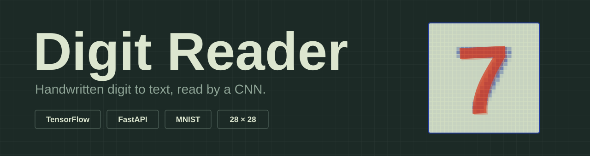
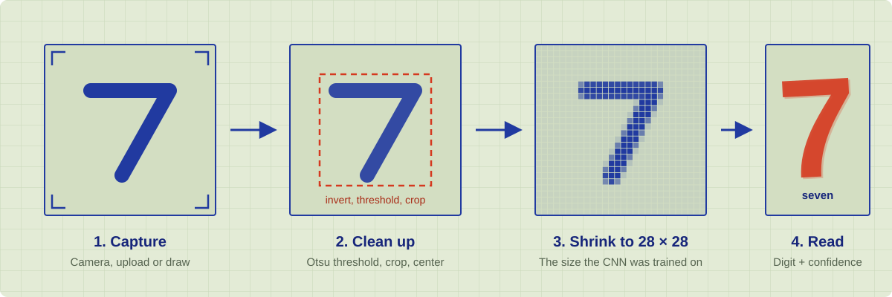

<div align="center">



<br>

[](https://digit-reader-using-cnn.onrender.com)


**Point a camera at a handwritten digit, or draw one, and get it back as text.**

[Live demo](https://digit-reader-using-cnn.onrender.com) · [How it works](#how-it-works) · [Run locally](#run-it-locally) · [API](#api-reference) · [Deploy](#deploy-on-render)

</div>

---

## Overview

**Digit Reader** is an end-to-end handwritten digit recognizer. A convolutional neural network trained on the MNIST dataset sits behind a FastAPI service, and a single-file web app lets you feed it digits three ways: live camera, photo upload, or drawing on the page.

It is built to cope with real photos rather than only clean MNIST test images. Photos are cleaned up, cropped and centered before the model sees them.

> **Try it now:** [digit-reader-using-cnn.onrender.com](https://digit-reader-using-cnn.onrender.com)
> The demo runs on Render's free tier, so the first request after a quiet period can take 30 to 60 seconds while the server wakes up.

## Features

| | |
|---|---|
| **Three ways in** | Open the camera and capture, upload or drop a photo, paste an image, or draw with a mouse or finger. |
| **Live drawing** | Draw mode reads automatically half a second after you lift the pen. |
| **See what the model sees** | The result panel shows the 28 × 28 grid the digit was reduced to. Hover or press and hold it to peek behind the stamp. |
| **Confidence and runners-up** | Every reading comes with a confidence score and the next two most likely digits. Low confidence is flagged. |
| **Robust preprocessing** | Auto-inversion, Otsu thresholding, noise rejection, cropping and center-of-mass centering. |
| **Clean JSON API** | Typed responses, size limits, health and readiness probes, and interactive docs at `/docs`. |
| **Copy and history** | Copy the result as text and revisit earlier readings in the session. |
| **3D network visualizer** | A scroll-driven tour of every layer, from the input pixels to the final decision, plus training curves, a confusion matrix and the filters the first layer learned. Open it from the **Visualize** button. |
| **Keyboard friendly** | `C` camera, `U` upload, `D` draw, `Space` capture, `Esc` close camera, `Ctrl+Z` undo a stroke. |

## How it works



1. **Capture.** The browser sends one image to `POST /v1/convert`. The camera crops to the on-screen frame and uploads are downscaled first to keep requests small.
2. **Clean up.** The API fixes EXIF rotation, flattens transparency onto white, converts to grayscale and inverts dark-on-light writing so the digit is bright on a dark background, as in MNIST. It then applies an Otsu threshold and keeps the largest block of ink, which drops stray specks and shadows.
3. **Shrink to 28 × 28.** The digit is cropped to its bounding box, scaled to fit 20 px, placed on a 28 × 28 canvas and centered by its center of mass. This matches how MNIST digits were prepared.
4. **Read.** The CNN outputs a probability for each digit 0 to 9. The API returns the best guess, its spelled-out word, the confidence and the top three candidates.

## Tech stack

- **Model:** TensorFlow / Keras CNN trained on MNIST, exported as `mnist_cnn.keras`
- **Backend:** FastAPI, Uvicorn, Pydantic v2, NumPy, Pillow, WebSockets
- **Modern Frontend (React):** React 18, Vite, GSAP 3, Lenis, Framer Motion, Tailwind CSS (served at `/react`)
- **Classic Frontend:** Standalone vanilla `index.html` (canvas, `getUserMedia`, zero build step)
- **3D Network Visualizer:** Three.js, GSAP ScrollTrigger, Lenis (served at `/visualize`)
- **Hosting:** Render

## Project structure

```text
Digit-Reader-using-CNN/
├── main.py                       # FastAPI app: preprocessing, inference, endpoints, WebSockets
├── index.html                    # Classic frontend served at "/" (camera, upload, draw)
├── visualize.html                # 3D network visualizer served at "/visualize"
├── visualize.py                  # Builds exported_model/viz_data.json for the visualizer
├── frontend/                     # Modern React frontend (Vite + GSAP + Lenis + Tailwind)
│   ├── src/                      # React components (DrawingPad, Camera, Upload, Results, History)
│   ├── dist/                     # Production build served at "/react"
│   └── package.json
├── requirements.txt              # Python dependencies
├── exported_model/
│   ├── mnist_cnn.keras           # Trained CNN
│   └── viz_data.json             # Training history and test results (made by visualize.py)
├── MNIST_CNN_Digit_Recognition (1).ipynb      # Model training notebook
├── CNN_Digit_Recognition_Project_Report (2).pdf   # Project report
└── assets/                       # README images
```

## Run it locally

**Requirements:** Python 3.10 or newer.

```bash
# 1. Clone
git clone https://github.com/devbytush/Digit-Reader-using-CNN.git
cd Digit-Reader-using-CNN

# 2. Create a virtual environment (recommended)
python -m venv .venv
source .venv/bin/activate        # Windows: .venv\Scripts\activate

# 3. Install dependencies
pip install -r requirements.txt

# 4. Start the server
uvicorn main:app --reload
```

Open **http://localhost:8000**. The app and the API are served from the same address, and `localhost` counts as a secure origin, so the browser will offer camera access.

- Interactive API docs: http://localhost:8000/docs
- Health check: http://localhost:8000/health

> **Seeing TensorFlow log lines on startup?** Messages about `cpu_feature_guard` or `absl::InitializeLog()` are informational and harmless. They only say TensorFlow is using your CPU's AVX2/FMA instructions.

### Testing the camera from a phone

Browsers only allow camera access on `localhost` or HTTPS. To test on a phone, expose port 8000 through an HTTPS tunnel such as ngrok or cloudflared and open the tunnel URL. The page and API then share one origin, so no extra setup is needed.

## Network visualizer

Press **Visualize** on the main page to see how the network reads your digit. Scroll to follow the signal through every layer in 3D, then see how the model was trained. Drag the scene to look around, hover a feature map for details, and use the **Try another digit** panel to draw or upload a new one and watch every layer update.

The 3D tour works out of the box. To add the training curves, test accuracy, confusion matrix and sample digits, generate the data once:

```bash
# in your training notebook, save the history
#   import json; json.dump(history.history, open("history.json", "w"))

python visualize.py --history history.json
```

This loads `exported_model/mnist_cnn.keras`, evaluates it on the MNIST test set and writes `exported_model/viz_data.json`. Commit that file to include the training section on your hosted demo. Offline? Pass a local copy of the dataset with `--mnist-npz mnist.npz`.

## API reference

### `POST /v1/convert`

Send one image as `multipart/form-data` in a field named `file`.

```bash
curl -X POST -F "file=@digit.jpg" https://digit-reader-using-cnn.onrender.com/v1/convert
```

**Response**

```json
{
  "text": "7",
  "digit": 7,
  "word": "seven",
  "confidence": 0.9931,
  "top_predictions": [
    { "digit": 7, "probability": 0.9931 },
    { "digit": 1, "probability": 0.0049 },
    { "digit": 2, "probability": 0.0011 }
  ],
  "warnings": []
}
```

`warnings` contains a message when confidence is below 70%.

**Errors**

| Status | Meaning |
|---|---|
| `400` | The uploaded file is empty |
| `413` | Image is over 10 MB or 20 megapixels |
| `415` | Not a supported or readable image |
| `422` | No digit found, or it is too small or faint |
| `503` | The model is not loaded |

### Other endpoints

| Endpoint | Purpose |
|---|---|
| `GET /` | The classic web app |
| `GET /react` | The modern React + GSAP + Lenis web app |
| `POST /v1/convert-base64` | Convert a base64-encoded image string to text |
| `GET /v1/metrics` | Model parameters, uptime, and request stats |
| `WS /ws/draw` | WebSocket for real-time streaming digit recognition |
| `GET /health` | Liveness probe |
| `GET /ready` | Readiness probe, succeeds once the model is loaded |
| `GET /visualize` | The 3D network visualizer |
| `GET /v1/model` | Architecture, kernels and training data for the visualizer |
| `POST /v1/trace` | Runs an image and returns every layer's activations |
| `GET /docs` | Interactive Swagger UI |

### Configuration

Settings can be overridden with environment variables prefixed `D2T_`:

| Variable | Default | Description |
|---|---|---|
| `D2T_MODEL_PATH` | `exported_model/mnist_cnn.keras` | Path to the Keras model |
| `D2T_CORS_ORIGINS` | localhost dev origins | JSON list of allowed origins, for example `["https://my-site.com"]` |
| `D2T_MAX_UPLOAD_BYTES` | `10485760` | Maximum upload size |
| `D2T_MAX_IMAGE_PIXELS` | `20000000` | Maximum image size in pixels |
| `D2T_LOW_CONFIDENCE_THRESHOLD` | `0.70` | Below this, a warning is returned |
| `D2T_ROBUST_PREPROCESSING` | `true` | Flatten uneven lighting, smooth noise and stretch contrast before locating the digit. Set `false` to restore the original pipeline (see [Pipeline accuracy](#pipeline-accuracy)) |

## Deploy on Render

1. Create a new **Web Service** from this repository.
2. Set the build command to `pip install -r requirements.txt`.
3. Set the start command to `uvicorn main:app --host 0.0.0.0 --port $PORT`.
4. Deploy. Render gives you a public HTTPS URL, which also satisfies the browser's camera requirement.

Because the frontend is served by the same app, it automatically calls the API on its own origin.

> **React app (`/react`).** `frontend/dist` is git-ignored, so `/react` only works if the build step runs
> (`cd frontend && npm ci && npm run build`). The command above installs Python dependencies only, so on a plain
> Python build `/react` returns 404 while `/` and `/visualize` still work. Add the frontend build to your build
> command if your build image provides Node.

## Development

```bash
pip install -r requirements-dev.txt
ruff check .          # lint
pytest -q             # unit + API tests (loads the real model; about 10 s)
```

CI (`.github/workflows/ci.yml`) runs the same checks plus the frontend build on every push and pull request.
Image preprocessing lives in `digitreader/preprocessing.py`, a pure module with no web-framework imports.

## Pipeline accuracy

The 98.96% in `exported_model/training_summary.json` is accuracy on clean 28x28 MNIST. Real uploads are photos, so
`eval/pipeline_eval.py` renders MNIST **test** digits as simulated photos under 13 conditions, runs them through the real
preprocessing and model, and compares pipeline variants on identical images (paired, with exact McNemar tests).

```bash
python eval/pipeline_eval.py --mnist-npz path/to/mnist_test.npz --n 1000
```

Results (1000 images per condition; raw data in `eval/results/pipeline_eval_variants.json`):

| Condition | Original pipeline | New default (`robust` + stretch) | Change |
|---|---|---|---|
| clean photo | 98.4% | 98.1% | no significant change |
| light on dark | 98.2% | 98.1% | no significant change |
| faint ink | 97.2% | 98.2% | no significant change |
| very faint ink | 96.5% | 98.2% | significant gain |
| blur | 98.4% | 98.3% | no significant change |
| noise | 80.9% | 98.4% | significant gain |
| rotated | 98.0% | 97.9% | no significant change |
| shadow | 75.9% | 92.8% | significant gain |
| small digit | 95.2% | 97.9% | significant gain |
| thick marker | 96.8% | 96.7% | no significant change |
| thin pen | 97.5% | 97.5% | no significant change |
| jpeg q30 | 98.3% | 98.4% | no significant change |
| combined hard | 13.8% | 97.9% | significant gain |

"Significant" means an exact McNemar p < 0.01, unadjusted for the 13 comparisons. Faint ink (p = 0.013) improves by a
similar amount but falls just outside that cut-off.

The original pipeline located the digit from per-column foreground occupancy under a single global Otsu threshold, so
sensor noise and lighting gradients broke it. The new default flattens the page background, smooths noise *only for
segmentation*, and stretches stroke contrast; the pixels that reach the model still come from the original image and
the final tensor is unchanged in form (28x28, 0-1, white on black, 20 px box, centred by centre of mass).

**Read this as a relative comparison, not a field accuracy guarantee.** The photos are simulated, the digits are MNIST
test digits, there is one random seed, and with 1000 images per condition each 95% interval is about +/-1 point near 98% accuracy and up to
+/-2.7 points near 76%. On clean photos the new default flipped 3 images the wrong way and none the right way (p = 0.25, not
distinguishable from chance), so a cost of up to about 0.3 points there cannot be ruled out. Real phone photos should be
evaluated before quoting a field number.

## Tips for the best results

- Write **one digit** in dark ink on plain paper.
- Fill the dashed frame with the digit and keep the lighting even, without shadows.
- If confidence is low, retake the photo closer and straighter, or draw the digit instead.

## Limitations

- The model reads **one digit at a time**, 0 to 9. Multi-digit numbers are not supported.
- It was trained on MNIST, so unusual styles, very thin strokes or heavy background texture can reduce accuracy.
- On the free Render tier the first request after idle time is slow.

## Roadmap

- [ ] Multi-digit numbers through digit segmentation
- [ ] Letter and symbol recognition (EMNIST)
- [ ] Test-time augmentation for tougher photos
- [ ] Dockerfile for one-command deployment
- [ ] Evaluate the pipeline on real phone photos (the current harness is simulated)

## Documentation

- Model training: [`MNIST_CNN_Digit_Recognition (1).ipynb`](<./MNIST_CNN_Digit_Recognition (1).ipynb>)
- Project report: [`CNN_Digit_Recognition_Project_Report (2).pdf`](<./CNN_Digit_Recognition_Project_Report (2).pdf>)

## Author

Built by **[@devbytush](https://github.com/devbytush)**. If this project helped you, consider giving it a star.

<div align="center">

<sub>Digit Reader · CNN · FastAPI · Render</sub>

</div>
